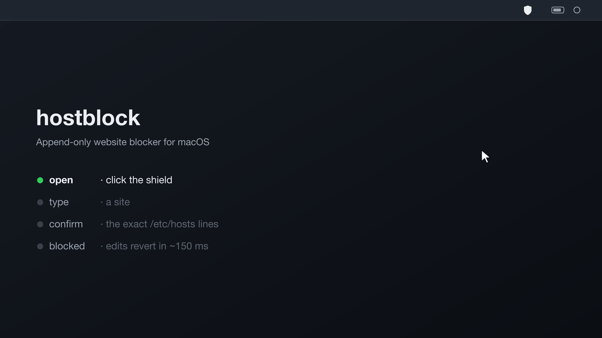
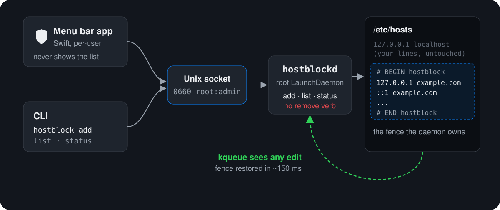

<p align="center">
  
</p>

<h1 align="center">hostblock</h1>

<p align="center">
  An append-only website blocker for macOS: once a site is in, it stays in.
</p>

<p align="center">
  <a href="https://github.com/esoteric-frog/hostblock/actions/workflows/ci.yml"></a>
  
  
  <a href="https://github.com/esoteric-frog/hostblock/releases"></a>
  <a href="./LICENSE"></a>
</p>

<p align="center">
  
</p>

Click the shield, type a site, confirm, and it is routed to `127.0.0.1` and `::1`
in `/etc/hosts` for good. A root daemon owns that section of the file, puts it back
within about 150 ms if anything edits it, and has no command to remove a site.

## Who it is for

hostblock is for people who are done negotiating with themselves.

If a site has a hold on you (porn, gambling, a social feed, a forum you
lose whole nights to), you already know how most blockers end. You set a
limit when you feel strong. Later, in a weak moment, you turn it off in
two clicks, and the limit was never really there. Screen Time, browser
extensions and timers all share that flaw: the person who sets the limit
can also lift it, right when it matters most.

hostblock takes that choice away from your weakest moment and leaves it
with your strongest one:

- **The decision is made once.** You choose to block a site when you are
  clear-headed. After you confirm, there is no button, menu or command to
  take it back.
- **The urge has nothing to bargain with.** Cravings tend to pass. The
  daemon simply outlasts them: edit `/etc/hosts` and the block is back in
  about 150 ms.
- **No list to stare at.** The menu bar never shows what you blocked, so
  the app itself never becomes a reminder or a trigger.
- **You must mean it.** Every add shows the exact lines and asks you to
  confirm, because every add is permanent.

This is not a gentle focus timer. It is for people who are committed to
real change and want their computer on their side. If you want a block you
can pause tomorrow, use something else.

A blocker removes easy access. It does not treat addiction. hostblock works
best as one part of a larger plan: people you trust, a support group, or a
professional. If you are struggling, reaching out to someone is the
strongest step you can take.

## Why it is different

1. **Append-only at the protocol level.** The daemon implements `add`, `list`,
   `status` and nothing else. There is no `remove` verb.
2. **Tamper reversion.** A root daemon watches `/private/etc` with kqueue and
   restores its fenced section within ~150 ms of any edit, replace, truncate or
   delete. Everything outside the fence is left alone.
3. **The GUI never shows what is blocked.** Plain shield, no count, tooltip
   never names a site, no list in the panel, and the panel never requests the
   blocklist. `hostblock list` in a terminal is the only place it is shown.
4. **Confirm before every add**, with the exact lines previewed.

## How it works

<p align="center">
  
</p>

- **`daemon/hostblockd`**: Python 3 stdlib only, run as a root `LaunchDaemon`.
  One `select()` loop over a kqueue and the control socket.
- **`cli/hostblock`**: unprivileged client. Talks to the socket; needs `admin` group.
- **`menubar/main.swift`**: `NSStatusItem` + `NSPopover`, run by a per-user
  `LaunchAgent`. It only shells out to the CLI.

## Install

Requires macOS with the Xcode Command Line Tools (`xcode-select --install`) for
`swiftc` and `/usr/bin/python3`.

```sh
git clone https://github.com/esoteric-frog/hostblock.git
cd hostblock
./build.sh       # compiles the menu bar app into build/
./install.sh     # asks for sudo once, then loads the daemon and the menu bar agent
```

`install.sh` puts the daemon in `/usr/local/libexec/hostblock`, the CLI in
`/usr/local/bin/hostblock`, state in `/Library/Application Support/hostblock`, and
saves a one-time copy of your original file to `/etc/hosts.pre-hostblock`.

## Usage

From the menu bar: click the shield, type a domain, press Return, confirm.

From a terminal:

```sh
hostblock add example.com           # also blocks www.example.com, on 127.0.0.1 and ::1
hostblock add https://example.com/a # pasted URLs are fine
hostblock list                      # the only place blocked sites are shown
hostblock status
```

Requires membership in the `admin` group (the control socket is `0660 root:admin`).

## Test

```sh
./test.sh
```

Runs the real daemon and CLI in a sandbox (`HOSTBLOCK_TEST_ROOT`): no root, no
change to the real `/etc/hosts`. It checks add, refusal of IP addresses, that no
remove verb exists, and that an edit and a delete are both reverted.

## Limitations

- **No wildcards.** `/etc/hosts` matches exact names.
- **`127.0.0.1` vs `0.0.0.0`.** A local webserver on port 80 will show its page.
- **Does not stop** direct-IP access, a VPN or proxy, a browser using
  DNS-over-HTTPS / secure DNS that skips the system resolver, or your phone. It
  does apply to private windows: it is system-level.
- **Open tabs keep working** until reloaded; browsers cache DNS themselves.
- **`.local` names** are Bonjour names on macOS and are rejected at input.
- **Screen Time** also blocks websites, but its limits are removable in a few
  clicks by the person who set them. That is the property this tool removes.
- Some VPN clients rewrite `/etc/hosts`; the daemon will fight them and the
  audit log is where that shows up.

## Undoing a block

There is no supported way from the UI or CLI. That is the feature. It takes
root, stopping the daemon, and hand-editing the daemon's JSON state, then
starting the daemon again. This is friction, not a lock.

## Linux and macOS

hostblock started as a Linux tool. The macOS port keeps the same four commitments;
this is what changed underneath:

| Linux | macOS |
| --- | --- |
| inotify on `/etc` | kqueue `EVFILT_VNODE` on the `/private/etc` directory AND on the current hosts inode (re-armed after every event) |
| systemd unit with sandboxing | `LaunchDaemon` (`launchctl bootstrap system`); the systemd hardening has no launchd equivalent and is simply gone |
| `resolvectl flush-caches` | `dscacheutil -flushcache; killall -HUP mDNSResponder` |
| `SO_PEERCRED` | `getpeereid(2)` via ctypes |
| `wheel` group | `admin` group |
| `/usr/bin/python3` (system) | `/usr/bin/python3` (Apple Command Line Tools shim, root-owned, Python 3.9) |
| Quickshell QML bar widget | Swift `NSStatusItem` + `NSPopover` app, run by a per-user `LaunchAgent` |
| GNU `install -D` | BSD `install -d` + `install -m` |

`HOSTBLOCK_TEST_ROOT` still relocates all paths and drops the root check, so the
watch/revert loop can be tested unprivileged. The socket path must stay short
(AF_UNIX limit is 104 bytes on macOS).

## Contributing

Bug reports and small, focused pull requests are welcome. Read
[CONTRIBUTING.md](./CONTRIBUTING.md) first; note that a `remove` verb will not be
accepted. Security issues go through [SECURITY.md](./SECURITY.md).

## License

[MIT](./LICENSE)

<p align="center">
  
</p>
